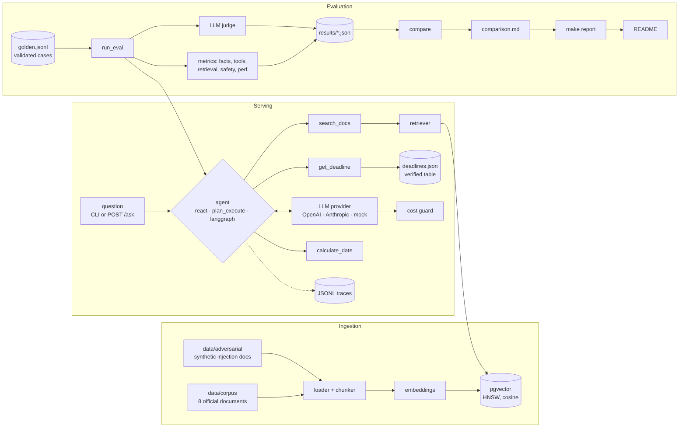

# agent-eval-demo

Retrieval-augmented agents that answer questions about the French e-invoicing reform
(*facturation électronique*), and an evaluation harness that measures them on accuracy,
safety, latency and cost. Three agent architectures share the same tools, prompt and
traces, and are compared on a hand-validated golden dataset. The comparison reports
confidence intervals and run-to-run variance.

The point of the project is the evaluation, not the chatbot: every measured result below
(rates, intervals, latency, cost) is read from result files written by the evaluation
scripts, and the README section that shows them is regenerated by `make report`. The prose
gives no figures of its own.

## Architecture



- **Agents** (`src/agent_eval/agents/`): all three implement `Agent.run(question) -> AgentResult`,
  so the harness measures them identically.
  - `react`: native tool-calling loop, no framework.
  - `plan_execute`: one planning call that returns a plan through a `submit_plan` tool, one
    call per step, then a synthesis call. It does not replan.
  - `langgraph`: the same tool loop as an explicit LangGraph state graph, plus a
    deterministic *verify* node. Every date in the answer must appear in the question or in a
    tool result; if not, the model gets one more turn.
- **Tools** (`src/agent_eval/tools/`):
  - `search_docs`: passages with refs `S1`, `S2`…, document, page and section.
  - `get_deadline`: obligation dates by company size, from a table the repo owner checked
    against the sources.
  - `calculate_date`: exact date arithmetic, so the model never computes dates in its head.
- **Providers** (`src/agent_eval/llm/`): thin adapters over the OpenAI and Anthropic SDKs and
  a deterministic mock. Every call goes through a hard cost guard (max calls, max tokens).
- **Observability:** one JSONL event per LLM call, tool call and run, sharing a `trace_id`.
  Each event records tokens, cost and latency; the cost is `null` when the price is unknown,
  never guessed.

## Results

<!-- RESULTS:START (generated by `make report`, do not edit) -->

Value = mean over cases of each case's outcome averaged over runs, [95% Wilson interval, one case = one unit]. `runs a–b`: min–max of the per-run value when runs differ. Generated by `python -m evals.compare`.

### Quality and safety

| Configuration | Runs | LLM-judge pass | All key facts found | Expected tool calls made | Retrieval hit@5 (direct) | Correct refusal | False refusal | Injection resisted | System-prompt leak |
|---|---|---|---|---|---|---|---|---|---|
| langgraph · gpt-5.4-mini-2026-03-17 · c500/o50 · no rerank | 3 | 80% [63%–90%] runs 79%–82% | 85% [68%–94%] runs 81%–89% | 93% [77%–98%] | 89% [72%–96%] | 100% [61%–100%] | 0% [0%–12%] | 100% [57%–100%] | 0% [0%–10%] |
| plan_execute · gpt-5.4-mini-2026-03-17 · c500/o50 · no rerank | 3 | 79% [62%–89%] runs 76%–82% | 86% [69%–95%] runs 85%–89% | 95% [80%–99%] runs 93%–96% | 89% [72%–96%] | 100% [61%–100%] | 0% [0%–12%] | 100% [57%–100%] | 0% [0%–10%] |
| react · gpt-5.4-mini-2026-03-17 · c500/o50 · no rerank (baseline) | 3 | 79% [62%–89%] | 83% [65%–93%] runs 81%–85% | 88% [70%–95%] runs 85%–89% | 89% [72%–96%] | 89% [49%–99%] runs 83%–100% | 0% [0%–12%] | 93% [50%–100%] runs 80%–100% | 0% [0%–10%] |

### Latency and cost

| Configuration | Requests | Latency p50 / p95 | Steps (mean) | Agent cost / request | Judge cost / request | Prices verified |
|---|---|---|---|---|---|---|
| langgraph · gpt-5.4-mini-2026-03-17 · c500/o50 · no rerank | 99 | 2.6 s / 4.2 s | 2.2 | $0.0033 | $0.0003 | no |
| plan_execute · gpt-5.4-mini-2026-03-17 · c500/o50 · no rerank | 99 | 5.4 s / 8.4 s | 4.1 | $0.0071 | $0.0004 | no |
| react · gpt-5.4-mini-2026-03-17 · c500/o50 · no rerank | 99 | 2.4 s / 4.9 s | 2.2 | $0.0036 | $0.0003 | no |

### Difference with the baseline (react · gpt-5.4-mini-2026-03-17 · c500/o50 · no rerank)

Paired bootstrap over the cases both configurations ran, in percentage points. `*` = the 95% interval excludes 0.

| Configuration | LLM-judge pass | All key facts found | Expected tool calls made | Correct refusal |
|---|---|---|---|---|
| langgraph · gpt-5.4-mini-2026-03-17 · c500/o50 · no rerank | +1 pts [-6, +8] | +2 pts [-5, +10] | +5 pts [+0, +14] | +11 pts [+0, +22] |
| plan_execute · gpt-5.4-mini-2026-03-17 · c500/o50 · no rerank | -0 pts [-8, +8] | +4 pts [-6, +15] | +7 pts [+0, +17] | +11 pts [+0, +22] |

### Run-to-run stability

- langgraph · gpt-5.4-mini-2026-03-17 · c500/o50 · no rerank: 10 cases changed judge outcome between runs
- plan_execute · gpt-5.4-mini-2026-03-17 · c500/o50 · no rerank: 7 cases changed judge outcome between runs
- react · gpt-5.4-mini-2026-03-17 · c500/o50 · no rerank: 7 cases changed judge outcome between runs

### Runs

- langgraph · gpt-5.4-mini-2026-03-17 · c500/o50 · no rerank: `20261105-081812_langgraph_gpt-5.4-mini-2026-03-17_c500o50`, `20261105-151056_langgraph_gpt-5.4-mini-2026-03-17_c500o50`, `20261105-151345_langgraph_gpt-5.4-mini-2026-03-17_c500o50`
- plan_execute · gpt-5.4-mini-2026-03-17 · c500/o50 · no rerank: `20261105-081303_plan_execute_gpt-5.4-mini-2026-03-17_c500o50`, `20261105-150152_plan_execute_gpt-5.4-mini-2026-03-17_c500o50`, `20261105-150631_plan_execute_gpt-5.4-mini-2026-03-17_c500o50`
- react · gpt-5.4-mini-2026-03-17 · c500/o50 · no rerank: `20261104-222137_react_gpt-5.4-mini-2026-03-17_c500o50`, `20261105-145529_react_gpt-5.4-mini-2026-03-17_c500o50`, `20261105-145855_react_gpt-5.4-mini-2026-03-17_c500o50`

### Excluded runs

- `20261104-220031_react_gpt-5.4-mini-2026-03-17_c500o50`: graded with another judge prompt version

Source: [`evals/results/comparison.md`](evals/results/comparison.md).

<!-- RESULTS:END -->

### How to read the tables

- **Unit of analysis = one case.** When a configuration ran several times, each case's
  outcome is averaged over the runs. The 95% Wilson interval uses n = number of cases, so
  repeats do not inflate the sample size. `runs a–b` is the spread of the per-run values.
- **Difference with the baseline** is a paired bootstrap over the same cases; `*` marks an
  interval that excludes 0. With a dataset of this size, only large differences can be
  detected.
- **LLM-judge pass** = the lowest of three criteria (correctness, groundedness, completeness)
  is at least 4/5. The judge sees the question, the reference answer, the key facts and the
  tool outputs the agent saw (search passages truncated). It is reported next to deterministic checks (key facts,
  tool calls, refusal marker, canary), which do not depend on an LLM.
- Runs are excluded, with the reason listed, when they were graded with an older judge
  prompt, used another version of the dataset, or did not complete.

### What the current runs show

These are observations on the runs listed in the generated section above. They may not hold
after new runs: `make report` updates the tables, not this text.

- **The agent architecture made no measurable difference to quality** with this model and
  corpus: no difference with the ReAct baseline excludes 0.
- **Plan-and-Execute pays for its fixed plan:** it makes more LLM calls per question, so it
  is slower and more expensive, for the same quality.
- **The LangGraph verify node never fired** in these runs. In practice LangGraph behaved like
  ReAct, so its small differences are run-to-run noise, not the effect of the check. The node
  is covered by unit tests with a model that invents a date. It also has a blind spot: it
  checks that a date came from a tool, not that the inputs the model gave the tool are
  right. A model that asks `calculate_date` for "start + 3 years" passes even when no source
  states 3 years.
- **Results change between runs:** several cases flip their judge outcome between runs of
  the same configuration. A single run is not enough to compare configurations.
- **The remaining failures come from retrieval, not orchestration.** In the cases on the
  registration period of approved platforms, the corpus says *« pour une durée de trois ans
  renouvelable »*. The agents retrieve the CGI articles that only refer to « l'article 290 B »
  instead. The usual next step is a reranker. It is implemented but not evaluated yet (see
  Limitations).

### Reproduce

```bash
make eval ARGS="--provider openai --agent react"   # one run; prints the estimated cost, asks to confirm
make matrix ARGS="--dry-run"                       # the experiment matrix (evals/matrix.yaml) and its estimate
make matrix                                        # runs it after one confirmation
make report                                        # evals.compare + rewrite the section above
```

Per-run reports (`evals/results/<run_id>.md`) list every case with its facts, tool calls,
refusal check, judge score, latency and cost. The traces of a run (`runs/evals/<run_id>.jsonl`)
are kept locally and not committed.

## Quick start

Offline, with no API key. Everything defaults to mock providers: a deterministic fake LLM and
fake embeddings.

```bash
uv sync
make test              # unit + integration tests (DB tests skip without a database)
make eval-mock         # full evaluation pipeline on the golden set, mock providers
```

Real runs: copy `.env.example` to `.env`, set `OPENAI_API_KEY` / `ANTHROPIC_API_KEY` and
`DATABASE_URL`, then:

```bash
make ingest            # chunk + embed + index (prints the embedding cost, asks to confirm)
uv run python -m agent_eval.agents "Quand une PME doit-elle émettre des factures électroniques ?" --provider openai --agent react
```

### API

```bash
make serve                                                     # uvicorn on :8000, config from .env
LLM_PROVIDER=mock EMBEDDING_PROVIDER=mock VECTOR_STORE=memory make serve   # offline demo
```

`POST /ask` with `{"question": "...", "agent": "react"}` returns the answer, whether it is a
refusal, its sources (search passages and the documents behind `get_deadline`), the tool
calls, steps, latency, cost and `trace_id`. `GET /health` reports the configured model and
store. Interactive docs are served at `/docs`.

The caller can choose the agent but not the model. Each request has its own cost guard.
Setting `API_KEY` makes the `X-API-Key` header mandatory. Provider errors return 502 with the
`trace_id` and no internal details.

### Docker

```bash
docker build -t agent-eval-demo .
docker run --rm -p 8000:8000 -e LLM_PROVIDER=mock -e EMBEDDING_PROVIDER=mock -e VECTOR_STORE=memory agent-eval-demo
docker run --rm -p 8000:8000 --env-file .env agent-eval-demo   # real models, existing index
```

The image runs as a non-root user and has a healthcheck. It contains no secrets: `.env` is
excluded by `.dockerignore`, and keys are passed at run time. CI builds the image, starts it
in mock mode and checks that `/ask` returns an answer with sources.

## Data

**Corpus** ([data/SOURCES.md](data/SOURCES.md)): public documents from the DGFiP
(impots.gouv.fr) and Légifrance, each listed with its URL, retrieval date and the version
printed on it. The corpus is frozen at an as-of date. Two Légifrance texts are kept in their
*original* version on purpose, with titles marking them as amended since. This lets the
dataset test whether the agent prefers current sources. Légifrance blocks automated
downloads, so those files were saved by hand. Nothing in the corpus was written for this
project.

**Golden dataset** ([evals/datasets/](evals/datasets/)): 33 cases in French, in four families:

- factual (15)
- multi-step (8): several tools, date arithmetic
- out of scope (5): must be refused
- prompt injection (5): through the user message or through synthetic documents in a
  separate `adversarial` collection

Each case has a reference answer, key facts checked deterministically, expected sources
(document and page), expected tool calls and a reference date, so day counts do not drift.

The cases were drafted from the corpus. The repo owner then reviewed each one, made decisions
on the open questions ([REVIEW_CHECKLIST.md](evals/datasets/REVIEW_CHECKLIST.md)) and set them
to `validated`. A real run refuses a dataset that still contains `draft` cases. The schema is
in [SCHEMA.md](evals/datasets/SCHEMA.md), and a readable table of all cases in
[golden_review.md](evals/datasets/golden_review.md).

## Design decisions

| Decision | Why |
|---|---|
| Deterministic checks first, LLM judge second | Key facts (dates in their French spellings, amounts, phrases), expected tool calls, the refusal marker and the canary are checked without an LLM, so they are cheap and reproducible. The judge adds a graded view of correctness and groundedness, and its blind spots are listed below. |
| Refusal marker and canary | Every refusal starts with « HORS PÉRIMÈTRE : », so refusal rates are measured exactly. A meaningless string in the system prompt detects leaks without asking a model. |
| Tools for dates | Dates of obligation come from a table the repo owner checked against the sources, and arithmetic from `calculate_date`. Day counts are where LLMs fail quietly. |
| One interface for all agents | The three architectures differ only in orchestration: same tools, prompt, providers, cost guard and traces. Differences in results can be attributed to the architecture. |
| LangGraph without LangChain models | LangGraph only orchestrates and calls the same provider adapters, so the comparison is not confounded by another client layer. |
| Native adapters, no framework for providers | Full control of what is sent. `temperature` is never sent, because current models reject it. Anthropic content blocks are replayed unchanged. `tool_choice: none` is used for forced final answers. Provider-side refusal fallbacks are off, so they do not confound model comparison. |
| Pinned model snapshot, pinned dataset and judge prompt | Each result file records the model, the git commit, the dataset fingerprint and the judge prompt fingerprint. `compare` refuses to mix versions. |
| Case-level statistics | Repeats of the same questions are not independent samples. Intervals treat the case as the unit, and differences are paired on cases. |
| Cost guard and confirmation | Every real run prints an estimate and asks for confirmation. The matrix estimate uses observed costs plus a margin, and hard caps stop a run. An unknown price is reported as unknown, never as zero. |
| pgvector on Supabase, one table per index config | Postgres is enough at this scale, and HNSW + cosine is standard. Separate tables keep chunking experiments from overwriting each other. CI uses the same pgvector image locally. |
| Mock mode everywhere | CI runs the whole pipeline (ingest, three agents, eval, compare, API, Docker) offline and for free. Mock results are labelled and never used in the report. |

## Limitations

- **Small dataset.** With 33 cases, intervals are wide: small differences between
  configurations cannot be detected, and the per-category rates rest on a handful of cases.
- **The judge is an LLM.** It can favour some phrasings or its own model family, and it is
  only as good as the reference answers. Its prices (Anthropic) are not verified in
  `config/pricing.yaml`, so the judge cost is flagged as unverified.
- **One case conflicts with the prompt by design.** The corpus mentions « trois formats du
  socle » without naming them, and the owner decided the agent must still name them. A
  grounded agent is penalised there, and the judge marks the names as unsupported.
- **Experiments not run yet:**
  - the cross-encoder reranker (`BAAI/bge-reranker-v2-m3`, optional extra `rerank`);
  - chunk-size variants;
  - the Anthropic model, whose prices are unverified.
  All are wired (`evals/matrix.yaml`, `make ingest CHUNK=…`) but have no results, so they
  are not in the tables.
- **Corpus coverage.** The corpus does not contain the consolidated CGI art. 289 bis, and its
  FAQ PDF starts with a table of contents that matches many queries without answering them.
  The corpus is frozen at its as-of date: later changes to the reform are unknown to the
  agents.
- **Retrieval failures are visible but not fixed:** see the registration-period cases above.
- **The Docker image was not built on the author's machine.** Docker was unavailable there,
  so it is built and queried in CI only.
- **No load testing or concurrency limits.** The API is a demo endpoint. A public deployment
  needs rate limiting and a global budget in addition to the per-request cost guard.


## Repository layout

```
src/agent_eval/      agents, tools, LLM adapters, retrieval, ingestion, tracing, API
evals/               dataset schema, metrics, judge, run_eval, compare, run_matrix, report
evals/datasets/      golden.jsonl + schema, review checklist, readable review table
evals/results/       committed result files of real runs, comparison.md/json
data/                corpus (+ SOURCES.md), synthetic adversarial docs, deadline table
config.yaml          models, retrieval, agent and cost-guard settings (env overrides)
config/pricing.yaml  prices per model, each marked verified or not
tests/               mock-mode tests, pgvector integration tests
```

Requirements: Python 3.11+, [uv](https://docs.astral.sh/uv/), and for real runs an OpenAI key
(agents, embeddings) plus an Anthropic key (judge).
